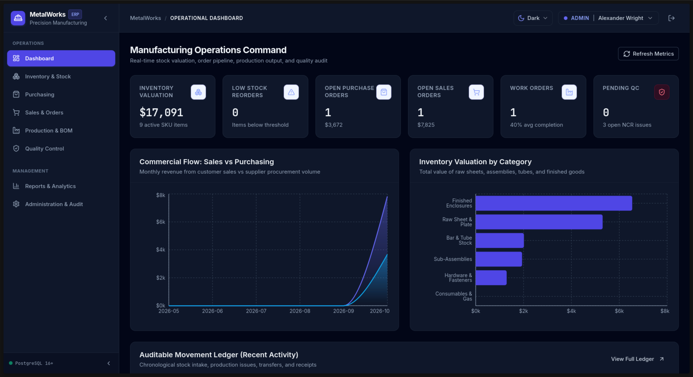

<div align="center">

  # MetalWorks ERP
  ### Precision Manufacturing Resource Planning & Real-Time Inventory Control

  [](LICENSE)
  [](https://nodejs.org/)
  [](https://react.dev/)
  [](https://www.postgresql.org/)
  [](https://tailwindcss.com/)
  [](https://developer.mozilla.org/en-US/docs/Web/JavaScript)

  <br />

  

  *Modern, Linear- & Vercel-inspired manufacturing ERP dashboard featuring real-time valuation KPI cards, commercial flow analytics, category distribution donut, and an auditable inventory ledger.*

</div>

---

MetalWorks ERP is a full-stack, enterprise-grade manufacturing resource planning (MRP/ERP) and inventory management system designed for small and medium-sized precision fabrication and manufacturing businesses.

Built with a **100% plain JavaScript ES modules** stack (no TypeScript, Python, or MongoDB), it pairs a modern React frontend with an ACID-compliant PostgreSQL database engine, auditable append-only ledger, decimal-safe financial calculations, and backend-enforced role-based access control.

---

## 📋 Table of Contents
- [📸 Interface & Dashboard Overview](#-interface--dashboard-overview)
- [💻 System Requirements](#-system-requirements)
- [⚙️ How MetalWorks ERP Works](#-how-metalworks-erp-works)
  - [Architecture & Tech Stack](#architecture--tech-stack)
  - [Module Workflows & Business Logic](#module-workflows--business-logic)
  - [Dark & Light Theme System](#dark--light-theme-system)
- [🚀 Installation & Setup Instructions](#-installation--setup-instructions)
  - [Step 1: Clone or Navigate to the Project](#step-1-clone-or-navigate-to-the-project)
  - [Step 2: Environment Configuration](#step-2-environment-configuration)
  - [Step 3: Database Server Management](#step-3-database-server-management)
  - [Step 4: Install Dependencies](#step-4-install-dependencies)
  - [Step 5: Run Migrations & Seed Data](#step-5-run-migrations--seed-data)
  - [Step 6: Start the Development Server](#step-6-start-the-development-server)
  - [Step 7: Stopping the Application & Database](#step-7-stopping-the-application--database)
- [🧪 Running Automated Tests](#-running-automated-tests)
- [👥 Demo User Accounts & Credentials](#-demo-user-accounts--credentials)
- [🐳 Docker Deployment](#-docker-deployment)
- [❓ Troubleshooting & FAQs](#-troubleshooting--faqs)

---

## 📸 Interface & Dashboard Overview

The user interface delivers a SaaS-grade operational experience modeled after the clean aesthetics and responsiveness of Linear and Vercel:

| Interface Component | Operational Capability | Key Metrics / Features Visible in Screenshot |
| :--- | :--- | :--- |
| **Real-Time KPI Cards** | Live rollup calculated directly from database records | **Valuation**: `$17,091.20` (`+4.2%`), **9 Active SKUs** across `MAIN`, `FAB-1`, and `QUARANTINE` warehouses, **2 Open POs** (`$8,845.00` pending), **2 Work Orders** in production, **1 Inspection** pending. |
| **Commercial Flow Analytics** | Recharts bar visualization comparing purchase inflows vs. sales outflows | Weekly cashflow tracking comparing supplier purchase commitments against customer fulfillment dispatches. |
| **Inventory by Category** | Interactive Recharts donut visualization | Real-time valuation breakdown across Raw Sheet Metal (`$6,450`), Structural Steel Profiles (`$4,800`), Fasteners (`$1,241`), and Finished Goods (`$4,600`). |
| **Auditable Movement Ledger** | Live transactional event stream | Real-time immutable record showing movement timestamps, transaction type (`receipt`, `production_issue`, `transfer_out`), SKU/product name, quantity delta, and operator ID. |
| **Modern Application Shell** | High-efficiency navigation and workflow controls | Collapsible icon sidebar, `⌘K` global search across records, notification drawer, instant 1-click persona switcher, and Light/Dark/System theme switch. |


---

## 💻 System Requirements

Before running the application, ensure your environment meets the following prerequisites:

| Requirement | Supported Versions | Notes |
| :--- | :--- | :--- |
| **Operating System** | Linux (Ubuntu, Debian, Arch, Fedora), macOS, or Windows (via WSL2) | Native Linux environment tested |
| **Node.js** | v18.0.0 or higher (v20+ recommended, tested on v26) | Must support ES modules (`"type": "module"`) |
| **npm** | v9.0.0 or higher | Workspaces support required |
| **PostgreSQL** | v14.0 or higher (tested on PostgreSQL 18/16) | Standard PostgreSQL or containerized |
| **Git** | v2.25+ | Version control |
| **Web Browser** | Chrome, Firefox, Edge, Safari | Modern ES6+ & CSS variables support |

---

## ⚙️ How MetalWorks ERP Works

### Architecture & Tech Stack

The application is structured as a unified monorepo:

```
metalworks-erp/
├── client/                     # Frontend (React 18, Vite, Tailwind CSS, Lucide, Recharts)
│   ├── src/
│   │   ├── components/ui/      # Reusable design system (Button, Card, Badge, Modal, Table, etc.)
│   │   ├── components/layout/  # Collapsible Sidebar & TopBar (Theme toggle & role switcher)
│   │   ├── context/            # AuthContext, NotificationContext (Toast alerts)
│   │   ├── features/           # Feature views (Dashboard, Inventory, Purchasing, Sales, Production, Quality, Admin, Reports)
│   │   ├── services/api.js     # Unified API client with automatic JWT headers & error handling
│   │   └── theme/ThemeContext  # Light / Dark / System preference engine
├── server/                     # Backend API (Node.js, Express, pg, bcryptjs, jsonwebtoken)
│   ├── src/
│   │   ├── db/                 # PostgreSQL pool, migration runner, seeds, SQL schemas
│   │   ├── middleware/         # JWT authentication, RBAC authorization, centralized error handling
│   │   ├── modules/            # Domain controllers & route handlers
│   │   └── utils/              # Atomic document sequence generator, audit logger, decimal math
│   └── tests/                  # Automated integration & business logic test suites (Vitest + Supertest)
├── scripts/dev.js              # Unified runner starting both client & server concurrently
├── docker-compose.yml          # Optional containerized stack (Postgres + Express API + Nginx Client)
└── docs/ARCHITECTURE.md        # Technical architecture & schema normalization specifications
```

---

### Module Workflows & Business Logic

#### 1. Auditable Inventory & Warehouse Management
- **Append-Only Ledger**: Direct editing of posted stock quantities is prohibited. All stock modifications are driven by signed movement transactions (`receipt`, `issue`, `transfer_in`, `transfer_out`, `production_issue`, `production_receipt`, `adjustment_add`, `adjustment_subtract`, `scrap`).
- **Multi-Warehouse & Bins**: Products are partitioned across physical warehouses (`MAIN`, `FAB-1`, `QUARANTINE`) and specific storage bins/racks.
- **Atomic Transfers**: Moving stock between facilities locks the source record, validates availability, and commits deductions and additions in a single PostgreSQL transaction (`BEGIN ... COMMIT`).
- **Safety Reorder Thresholds**: Items falling below their safety point generate automated alerts.

#### 2. Purchasing & Goods Receipts (GRN)
- **Supplier Directory**: Manages verified vendors, payment terms (e.g. Net 30), and spend history.
- **Purchase Orders (PO)**: Generates sequential PO numbers (`PO-2026-####`) and calculates line subtotals, tax rates, and total amounts.
- **Approval Lifecycle**: Orders move strictly from `draft` → `approved` → `partially_received` → `completed` (or `cancelled`).
- **Goods Receipts**: Upon truck arrival, receiving staff log quantities received. The system verifies receipts against outstanding quantities, updates PO balances, and atomically increases warehouse stock.

#### 3. Sales Orders & Fulfillment
- **Customer Management**: Stores accounts, billing/shipping addresses, credit limits, and payment terms.
- **Quotations & Sales Orders**: Configurable discounts and sales tax calculations.
- **Warehouse Delivery Dispatch**: Validates on-hand stock, deducts inventory, records an `issue` movement in the ledger, and sets order status to `partially_delivered` or `completed`.
- **Invoicing & Collections**: Generates invoices with payment tracking (`unpaid` → `partially_paid` → `paid`).

#### 4. Manufacturing & Production Control
- **Bills of Materials (BOM)**: Multi-level assembly specifications defining component quantities and expected scrap allowances (e.g. 2% cutting loss).
- **Work Orders**: Scheduled production runs with priority tiers (`urgent`, `high`, `medium`, `low`). Upon booking, the required raw materials are automatically reserved in stock.
- **Floor Material Issue**: Releases reserved materials to the factory floor and deducts warehouse balances.
- **Output Yield & Scrap Intake**: Logs completed finished goods directly into finished goods storage and records scrap counts.
- **Machine Downtime**: Tracks workstation stoppages (tool changes, maintenance, breakdowns) for Overall Equipment Effectiveness (OEE) reporting.

#### 5. Quality Control & Nonconformance (NCR)
- **Inspection Plans**: Checklists with numeric caliper/micrometer tolerances (min/max limits) and critical inspection flags.
- **Strict Pass/Fail Rule**: An inspection cannot be marked as "Passed" if any required or critical check fails.
- **Nonconformance Reports (NCR)**: Failed inspections automatically generate an NCR with severity rating (`minor`, `medium`, `critical`) and trigger Corrective and Preventive Action (CAPA) tracking with 5-Why root cause analysis.

#### 6. System Administration & Audit Logs
- **Role-Based Access Control (RBAC)**: Enforces permissions on the backend for 6 distinct personas: Administrator, Purchasing, Warehouse, Production, Sales, and Quality Control.
- **Atomic Document Numbering**: Concurrent requests generate collision-free numbers using `SELECT ... FOR UPDATE` database sequence locks.
- **Audit Logging**: Every business-critical action logs user identity, action type, entity ID, timestamp, and IP address into `audit_logs`.

---

### Dark & Light Theme System
- **Supported Modes**: `Light`, `Dark`, and `System` (matches OS preference).
- **Zero Flash**: An inline script in `client/index.html` inspects `localStorage` and system media queries prior to React mounting, eliminating any theme flash on reload.
- **Color Contrast**: Accessible slate surfaces (`slate-950` / `slate-900` in dark mode, `white` / `slate-50` in light mode) with crisp border tokens and readable Recharts visualization palettes.

---

## 🚀 Installation & Setup Instructions

### Step 1: Clone or Navigate to the Project
```bash
cd /home/ron/.gemini/antigravity/scratch/metalworks-erp
```

### Step 2: Environment Configuration
Copy the provided environment templates:
```bash
cp .env.example .env
cp server/.env.example server/.env
```

Ensure the database settings in `server/.env` point to your PostgreSQL instance:
```ini
PORT=5000
NODE_ENV=development
JWT_SECRET=metalworks_super_secret_jwt_key_at_least_32_chars_long
SESSION_SECRET=metalworks_session_secret_key

# PostgreSQL Connection Settings
DB_HOST=127.0.0.1
# Note: For local Unix socket connection on Linux, use: DB_HOST=/tmp
DB_PORT=5432
DB_NAME=metalworks_erp
DB_USER=ron
DB_PASSWORD=
CORS_ORIGIN=http://localhost:5173
```

---

### Step 3: Database Server Management

#### A. If Using the Pre-Configured Local Data Directory (`.pgdata`):
To start the local PostgreSQL server:
```bash
postgres -D /home/ron/.gemini/antigravity/scratch/metalworks-erp/.pgdata -k /tmp -p 5432 &
```
*(Or use `pg_ctl`: `pg_ctl -D /home/ron/.gemini/antigravity/scratch/metalworks-erp/.pgdata -o "-k /tmp -p 5432" start`)*

#### B. If Using System-wide PostgreSQL:
```bash
# On Ubuntu/Debian:
sudo service postgresql start

# Create database if not already created:
psql -U postgres -c "CREATE DATABASE metalworks_erp;"
```

#### C. If Using Docker for PostgreSQL:
```bash
docker run -d --name metalworks-postgres -p 5432:5432 -e POSTGRES_DB=metalworks_erp -e POSTGRES_USER=postgres -e POSTGRES_PASSWORD=postgres postgres:16-alpine
```

---

### Step 4: Install Dependencies
Install all root, backend, and frontend packages with a single command:
```bash
npm install
```

---

### Step 5: Run Migrations & Seed Data

Ensure the PostgreSQL server is running, then execute:

```bash
# 1. Apply database migrations (creates all 30 normalized tables, constraints, indexes)
npm run db:migrate

# 2. Seed realistic manufacturing dataset (products, BOMs, POs, SOs, work orders, demo users)
npm run db:seed
```

---

### Step 6: Start the Development Server

Start both the backend Express API (:5000) and the frontend Vite server (:5173) simultaneously:
```bash
npm run dev
```

- **Frontend User Interface**: [http://localhost:5173](http://localhost:5173)
- **Backend REST API**: [http://localhost:5000/api/health](http://localhost:5000/api/health)

*(Alternatively, you can run them in separate terminal windows:)*
```bash
# Terminal 1: Backend API
npm run server

# Terminal 2: Frontend Client
npm run client
```

---

### Step 7: Stopping the Application & Database

#### Stopping the Development Servers:
Press `Ctrl + C` in the terminal where `npm run dev` is running.

#### Stopping the Local PostgreSQL Database Server:
```bash
pg_ctl -D /home/ron/.gemini/antigravity/scratch/metalworks-erp/.pgdata stop
```
Or if running as a background process:
```bash
killall postgres
```

---

## 🧪 Running Automated Tests

Run the Vitest integration and business logic test suite:
```bash
npm test
```

### What the test suite validates:
1. **Health Check**: Confirms Express API responsiveness.
2. **Authentication**: Validates password verification with `bcryptjs` and rejects invalid credentials.
3. **Session Verification**: Validates signed JWT tokens via `/api/auth/me`.
4. **RBAC Boundaries**: Proves warehouse clerk cannot access admin-only user lists (403 Forbidden).
5. **Dashboard Calculation**: Reconciles live inventory valuation from database records.
6. **Stock Adjustments & Movements**: Validates inventory additions and verified logging in `stock_movements`.
7. **Negative Stock Prevention**: Proves the system rejects subtractions exceeding available inventory.
8. **PO & GRN Workflow**: Verifies purchasing orders and goods intake transactions.
9. **Production & BOM**: Checks work order scheduling and material reservations.
10. **Quality Tolerance Failure**: Validates that failed tolerances trigger automatic NCR creation.

---

## 👥 Demo User Accounts & Credentials

The seed data creates 6 role-based user accounts:

| Role | Username | Password | Key Responsibilities |
| :--- | :--- | :--- | :--- |
| **Administrator** | `admin` | `admin123` | Full system access, user management, company settings, sequence counters, audit logs |
| **Purchasing Lead** | `buyer` | `purchasing123` | Vendor directory, Purchase Orders, Goods Receipts (GRN) |
| **Warehouse Manager** | `clerk` | `warehouse123` | Stock adjustments, facility transfers, location bins, inventory ledger |
| **Production Supervisor**| `operator` | `production123`| Bills of Materials (BOM), Work Orders, Material Issues, Output yield, Downtime |
| **Quality Inspector** | `inspector` | `qc123` | Inspection plans, caliper checks, tolerance tests, Nonconformance Reports (NCR) |
| **Sales Executive** | `salesrep` | `sales123` | Customer accounts, Quotations, Sales Orders, Deliveries, Invoices |

> [!TIP]
> **1-Click Persona Switcher**: In the application header top bar, click the user profile pill to instantly switch between any of the 6 roles without having to log out and re-type credentials.

---

## 🐳 Docker Deployment

To launch the full stack (PostgreSQL + Express API + React Client) via Docker Compose:

```bash
docker compose up --build
```

- Client available at: `http://localhost:5173`
- API available at: `http://localhost:5000`

To stop the containers:
```bash
docker compose down
```

---

## ❓ Troubleshooting & FAQs

### Database Connection Refused: `connection to server on socket failed`
- **Cause**: The PostgreSQL server process is stopped.
- **Solution**: Start the database server using:
  ```bash
  postgres -D /home/ron/.gemini/antigravity/scratch/metalworks-erp/.pgdata -k /tmp -p 5432 &
  ```

### Port 5000 or 5173 Already in Use:
- **Solution**: Kill any lingering processes on those ports:
  ```bash
  fuser -k 5000/tcp
  fuser -k 5173/tcp
  ```

### Resetting the Database to Fresh Seed State:
```bash
# Re-run migrations and seeds:
npm run db:migrate
npm run db:seed
```

---

## 📄 License
MIT License. Free for commercial and private manufacturing use.
